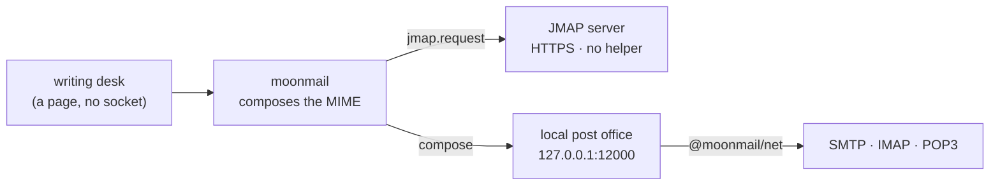

# moonmail

<p>
  <a href="https://moonbitstack.github.io/moonmail/"><b>Home</b></a> ·
  <a href="https://moonbitstack.github.io/moonmail/guide.html">Guide</a> ·
  <a href="https://moonbitstack.github.io/moonmail/api.html">API</a> ·
  <a href="https://moonbitstack.github.io/moonmail/desk.html">Showcase</a> ·
  <a href="https://mooncakes.io/docs/moonbitstack/moonmail">MoonCakes</a>
</p>

Email for MoonBit: read an RFC 5322 message into a tree and write it back out,
the MIME transfer encodings it carries, DKIM signing and verification, the
SMTP/LMTP, IMAP and POP3 dialogues, and JMAP over HTTP. The protocols are state
machines with no I/O, octets in and replies out, so a socket, a TLS stream and a
test all look alike; `@moonmail/net` carries them over moonnet.

```moonbit
let raw = @utf8.encode(
  "From: Alice <alice@example.com>\r\n" +
  "To: Bob <bob@example.com>\r\n" +
  "Subject: =?utf-8?B?THVuY2g/?=\r\n" +
  "Date: Fri, 06 Nov 2026 12:00:00 +0000\r\n" +
  "MIME-Version: 1.0\r\n" +
  "Content-Type: text/plain; charset=utf-8\r\n" +
  "\r\n" +
  "Noon works.\r\n",
)
let message = @moonmail.Message::parse(raw[:])
assert_eq(message.subject(), Some("Lunch?"))
assert_eq(message.from()[0].address, "alice@example.com")
assert_eq(message.text(), Some("Noon works.\r\n"))
```

Every call that talks to a server raises its protocol's error on a rejection;
handle it with `catch`, or propagate it from a function declared `raise`.

Run the whole surface in one go:

```bash
moon run src/examples/tour
```

## What it does

- **Messages** — `Message::parse` and `encode`: the header unfolded and folded
  again at 78 columns, a `Headers` table that keeps order and ignores case and
  refuses a value that would start a second field, `Body` as a leaf, parts or an
  attached message, and the transfer encodings taken off and put back. Writing
  what was read and reading it again gives the same tree.
- **Addresses and dates** — RFC 5322's address grammar in full, groups and the
  obsolete forms included, checked against Python's `email`; RFC 5322 dates
  with the old two-digit years and named zones.
- **Building** — `Message::new` picks `alternative`, `related` and `mixed` from
  what it carries. Quoted-printable, encoded words and charsets come from
  [moonmime](https://github.com/moonbitstack/moonmime).
- **SASL** (`@moonmail/sasl`) — PLAIN, LOGIN, CRAM-MD5, XOAUTH2, OAUTHBEARER
  (RFC 7628) and SCRAM-SHA-256 (RFC 7677) with SASLprep (RFC 4013). A
  mechanism is a trait: one you write goes to `authenticate` like these.
- **POP3** (`@moonmail/pop3`) — client with no I/O, RFC 1939 and RFC 2449:
  `USER`/`PASS`, `APOP`, SASL `AUTH`, `STLS`, `CAPA`, `PIPELINING`, `STAT`,
  `LIST`, `UIDL`, `RETR` and `TOP` dot-unstuffed with their octets kept.
- **SMTP / LMTP** (`@moonmail/smtp`) — client and server as state machines
  with no I/O, RFC 5321 and RFC 2033: `PIPELINING` groups, `SIZE`, `8BITMIME`,
  `BINARYMIME` and `CHUNKING`, `SMTPUTF8`, DSN parameters, `STARTTLS`, SASL
  `AUTH`, and RFC 3463 enhanced status codes off any reply.
- **Over a socket** (`@moonmail/net`, native and wasm) — the SMTP, LMTP, IMAP
  and POP3 state machines on moonnet: implicit TLS, STARTTLS that a server must
  offer, or the clear; sending one message in one call.
- **IMAP** (`@moonmail/imap`) — IMAP4rev2 client with no I/O (RFC 9051) that
  also speaks to IMAP4rev1 servers: the response grammar with literals and
  response codes, pipelined UID commands, `IDLE`, `CONDSTORE`, `LITERAL+`,
  `SASL-IR`, and modified UTF-7 names toward rev1 servers. The same package
  carries a server: `Server` and `Store` answer IMAP4rev1 from mailboxes in
  memory, which is what a conformance run points a client at.
- **DKIM** (`@moonmail/dkim`) — RFC 6376 canonicalization (simple and relaxed),
  body hash, and RSA-SHA256 and Ed25519-SHA256 (RFC 8463) sign and verify,
  checked in both directions against dkimpy.
- **JMAP** (`@moonmail/jmap`) — RFC 8620's envelopes and every one of the
  twenty-seven methods RFC 8621 and the core document define: mailbox, thread,
  letter, snippet, identity, submission and vacation response, over the five
  standard shapes plus `Email/copy`, `Email/import`, `Email/parse` and
  `Core/echo`. The objects are written down once as
  [moonmodel](https://github.com/moonbitstack/moonmodel) descriptions, which
  project to JSON Schema and are what `@moonmail/jmap/validate` checks a
  document against.

## Messages

`Message::new` builds the nesting from what it is given, and the result is the
octets a mail server expects:

```moonbit
let reply = @moonmail.Message::new(
  from=@moonmail.Mailbox::new("alice@example.com", name="Alice"),
  to=[@moonmail.Mailbox(@moonmail.Mailbox::new("bob@example.com"))],
  subject="Re: lunch",
  text="Noon works.\n",
)
let wire = reply.encode(utf8=true)
let again = @moonmail.Message::parse(wire[:])
assert_eq(again.subject(), Some("Re: lunch"))
assert_eq(again.text(), Some("Noon works.\n"))
```

`encode(utf8=true)` writes the octets as they are (RFC 6532). Left out, it
writes encoded words and a transfer encoding that seven-bit transport can
carry.

## POP3

```moonbit
let pop = @pop3.Client::new()
ignore(pop.user("alice"))
ignore(pop.pass("secret"))
ignore(pop.retr(1))
let events = pop.feed(@utf8.encode("+OK 12 octets\r\nSubject: one\r\n\r\nbody\r\n.\r\n")[:])
assert_eq(events.length(), 1)
```

Octets go in through `feed` and out through `next_write`; the client queues
commands and, with `PIPELINING`, sends a group of them before reading a reply.

## SMTP / LMTP

The client queues commands and refuses, when they are queued, the ones that are
out of sequence or need an extension the server did not announce.

```moonbit
let smtp = @smtp.Client::new()
smtp.ehlo("client.example")
let _ = smtp.mail("alice@example.com")
let _ = smtp.rcpt("bob@example.com")
let replies = smtp.feed(@utf8.encode("250 mx.example\r\n250 2.1.0 Ok\r\n250 2.1.5 Ok\r\n")[:])
assert_eq(replies.length(), 2)
for event in replies {
  match event {
    Reply(Rcpt(to), reply) if !reply.is_ok() => println("refused: " + to)
    _ => ()
  }
}
```

The server answers syntax, sequence, limits, the `354` and the chunk replies
itself, and hands the application what it decides:

```moonbit
let server = @smtp.Server::new("mx.example", auth=["PLAIN"])
server.feed(@utf8.encode("EHLO client.example\r\n")[:])
let request = server.next()
assert_true(request is Some(Hello(_, extended=true)))
server.reply(250, "mx.example")
assert_eq(server.next_write().unwrap().length() > 0, true)
```

`lmtp=true` on either side speaks LMTP, where the message gets one reply per
accepted recipient.

## JMAP

SMTP, IMAP and POP3 begin with a socket, and a browser has none: no API it can
call opens a TCP connection, so no amount of WebAssembly puts the three on a
page. JMAP puts the same three jobs — list the mailboxes, read a letter, send
one — over HTTPS as JSON documents, which a page can fetch like any other
resource. `@moonmail/jmap` therefore builds and reads documents and never
touches a socket.

```moonbit
let request = @jmap.Request::new()
let boxes = request.mailbox_get("u-1")
let found = request.email_query("u-1", "mb-in", 25)
assert_eq(boxes, "c0")
assert_eq(found, "c1")
let answer = @jmap.Response::parse(
  "{\"methodResponses\":[[\"Email/query\",{\"ids\":[\"em-1\"]},\"c1\"]],\"sessionState\":\"s-2\"}",
)
assert_eq(@jmap.email_ids(answer, found), ["em-1"])
```

Each method is one builder: `get`, `changes`, `set`, `query`, `queryChanges`
and `copy` are the standard shapes and each takes a `Kind`, so a misspelled
type is a compile error rather than an `unknownMethod`; the arguments RFC 8621
adds on top are named after the specification:

```moonbit
let request = @jmap.Request::new()
let _ = request.email_get(
  "u-1",
  ["em-1"],
  ["id", "subject", "bodyValues"],
  fetch_html_body_values=true,
  max_body_value_bytes=256,
)
let _ = request.email_import(
  "u-1",
  Map([
    (
      "one",
      @jmap.EmailImport::new(
        blob_id="B1",
        mailbox_ids=["mb-in"],
        keywords=["$seen"],
      ),
    ),
  ]),
)
let _ = request.search_snippet_get("u-1", ["em-1"], filter=@jmap.text_search("noon"))
assert_eq(@jmap.method_names().length(), 27)
```

```moonbit
assert_eq(@jmap.Kind::Email.methods().length(), 8)
assert_true(@jmap.has_property("Email", "subject"))
assert_false(@jmap.has_property("Email", "subjectLine"))
```

`@jmap.properties("Email")` answers the property names of an object, and
`@jmap.model("Email")` its description, which `@moonmodel/json` projects to
JSON Schema. A document can be checked against it:

```moonbit
let answer = @jmap.Response::parse(
  "{\"methodResponses\":[[\"Email/get\",{\"list\":[{\"id\":\"em-1\",\"subject\":\"Lunch?\"}]},\"c0\"]],\"sessionState\":\"s-2\"}",
)
assert_true(@validate.valid("Email", @jmap.email_object(answer, "c0")))
```

`@validate.faults` names what is wrong when it is not.

A message becomes the object a server answers `Email/get` with, which is how a
server or an importer builds one:

```moonbit
let object = @jmap.email_from_message(
  raw[:],
  mailbox_ids=["mb-in"],
  keywords=["$seen"],
  received_at="2026-11-06T12:00:01Z",
)
assert_true(@validate.valid("Email", object))
```

## The writing desk, and the post office beside it

The desk at [moonbitstack.github.io/moonmail/desk.html](https://moonbitstack.github.io/moonmail/desk.html)
writes a letter with this library and then has to send it. A page cannot: no
Web API opens a TCP connection, so the three socket protocols are out of reach
of the tab the letter was written in.

Two ways remain, and the desk offers both:

- **JMAP** — JSON over HTTPS, so the page fetches the server itself. Nothing to
  install, but only a server that speaks JMAP can be reached.
- **Local office** — the page hands the letter to `127.0.0.1`, and a small
  server there opens the SMTP, IMAP or POP3 connection. Works with any
  provider; needs that server to be running.



The office is a plugin, not part of the library: it lives on the `postoffice`
branch, and `moon run src/postoffice` serves the page and the three endpoints
it calls.

One limit is worth stating rather than discovering: the bundled TLS client
speaks TLS 1.3 only. A server that offers just 1.2 does not answer with a
version error — it hangs up during the handshake, which reads like a wrong
password if you are holding one. Personal QQ Mail is such a server; 163, 126,
Tencent Exmail, Aliyun and Fastmail all negotiate 1.3 and work. Reaching a
1.2-only server needs a client that speaks it, or JMAP.

## Over a socket

`@moonmail/net` carries the state machines over moonnet. `StartTls` refuses a
server that does not offer it rather than going on in the clear.

```moonbit native
let letter = @moonmail.Message::new(
  from=@moonmail.Mailbox::new("alice@example.com"),
  to=[@moonmail.Mailbox(@moonmail.Mailbox::new("bob@example.com"))],
  subject="Lunch",
  text="Noon works.\n",
)
let smtp = @net.Smtp::connect("smtp.example.com", Clear)
smtp.auth(@sasl.Plain::new("alice", "secret"))
let refused = smtp.send("alice@example.com", ["bob@example.com"], letter.encode())
assert_eq(refused.length(), 0)
smtp.quit()
```

The same shape carries IMAP and POP3: `@net.Imap::connect(host, Clear)` then
`login`, and `@net.Pop3::connect(host, Clear)` then `retr`. Passing
`@net.Tls(tls)` or `@net.StartTls(tls)` needs a `@tls.Client` from moontls with
the roots to trust.

## SASL

SMTP's `auth` and IMAP's and POP3's `authenticate` take any
`&@sasl.Mechanism`; the protocol does the base64 and the cancelling.

```moonbit
// SCRAM never sends the password, and refuses a server that cannot prove it
// holds the salted key. The nonce is fresh random printable ASCII each time.
let mechanism = @sasl.ScramSha256::new("alice", "secret", nonce="fyko+d2lbbFgONRv9qkxdawL")
assert_eq(mechanism.name(), "SCRAM-SHA-256")
let first = mechanism.start().unwrap()
assert_true(first.length() > 0)
```

A mechanism of your own implements `name`, `start` and `step`, and `finish`
when it expects proof from the server.

## IMAP

Each command returns its tag number; `feed` reports untagged responses as
`Data` and each completion as `Done` with that number.

```moonbit
let imap = @imap.Client::new()
let login = imap.login("alice", "secret")
let selected = imap.select("INBOX")
let fetch = imap.fetch("1:*", "(FLAGS BODY.PEEK[HEADER])", uid=true)
assert_eq([login, selected, fetch], [0, 1, 2])
let events = imap.feed(@utf8.encode("1 OK LOGIN completed\r\n")[:])
assert_eq(events.length(), 1)
```

The tags pair a `Done` with the command that asked for it, which is what lets a
client pipeline: `fetch` above was queued before the answer to `select`
arrived.

## DKIM

```moonbit
let verdicts = @dkim.verify(raw[:], _ => None, now=0)
assert_eq(verdicts.length(), 0)
```

`sign` takes a `@dkim.Key` — RSA or Ed25519 — and answers the whole
`DKIM-Signature` line to put above the fields it signed:

```moonbit
// `key` is a @dkim.Key from @x509.PrivateKey::pem; the lookup answers the TXT
// record of the selector, which verify asks for once per signature.
let domain_name = "sel._domainkey.example.com"
assert_eq(domain_name, "sel._domainkey.example.com")
```

## A server, for the other end of the wire

A client is half a protocol. `@moonmail/imap` also carries the server side:
`Store` holds mailboxes, messages, flags and UIDs in memory, and `Server` turns
octets into answers.

```moonbit
let store = @imap.Store::new()
let _ = store.deliver("INBOX", raw[:], date="06-Nov-2026 12:00:00 +0000")
let server = @imap.Server::new(
  store~,
  credentials=(user, password) => user == "tim" && password == "secret",
  clock=() => "06-Nov-2026 12:00:00 +0000",
)
server.feed(@utf8.encode("a1 LOGIN tim secret\r\n")[:])
assert_true(server.next_write() is Some(_))
```

It is a reference server, not a mail store: nothing outlives the process and no
message is written to disk. `moon run src/examples/imap-server -- 1142` puts it
on a socket with one account, `tim` / `secret`, which is what the conformance
run in this repository points imaptest at.

## Conformance

Each package follows its specification as written, and the parts a server can
answer for are exercised against one. Dovecot 2.4 serves IMAP and POP3 and takes
the messages Postfix 3.10 delivers; the Dovecot project's own `imaptest` fills a
mailbox this library then reads, and drives the server this library builds. Its
scripted tests say what a server answers, and all 676 of their replies are
replayed through this client: 665 are read back as written, and the eleven that
are not are named in `src/imap/imaptest_wbtest.mbt` with the reason.

DKIM is checked in both directions against dkimpy: nine signatures it made are
verified here, and six this library made are verified by it.

| Package | Specification | Worth knowing |
|:--|:--|:--|
| `moonmail` | RFC 5322, 2045, 2046, 6532 | Writing what was read and reading it again gives the same tree, byte for byte. |
| `moonmail/smtp` | RFC 5321, 1870, 6152, 6531, 2920, 3030, 3207, 4954, 3461 | Pipelining, chunking and DSN follow what the server announces; a command that needs an extension it did not announce is refused when it is queued, not when it is sent. |
| `moonmail/imap` | RFC 9051, 2177, 7162, 3501 | Toward a server that announced neither IMAP4rev2 nor `UTF8=ACCEPT`, names are written and read in modified UTF-7. A search for text outside US-ASCII has to name its charset and quote the string. Of imaptest's 676 scripted replies, 665 are read back as written; the eleven that are not are six `LSUB` replies (read into the same value as `LIST`, which IMAP4rev2 dropped), two carrying the extended data of `LIST-EXTENDED` (RFC 5258), two names in modified UTF-7 that come back decoded, and one with two literals in one line. |
| `moonmail/pop3` | RFC 1939, 2449 | The line limit covers status lines, which the protocol bounds; a line of a message has no length of its own and is bounded by the message limit instead. |
| `moonmail/dkim` | RFC 6376, 8463 | Both canonicalizations, RSA-SHA256 and Ed25519-SHA256, `l=`, `t=`, `x=` and `h=` checked item by item, and interoperable with dkimpy in both directions. |
| `moonmail/sasl` | RFC 4616, 7677, 7628, 4013 | SCRAM-SHA-256 checks the server's signature before the session is trusted; PLAIN, LOGIN, CRAM-MD5, XOAUTH2 and OAUTHBEARER complete it. |
| `moonmail/jmap` | RFC 8620, 8621 | Twenty-seven methods and eighteen objects, the objects described once in moonmodel: `@moonmail/jmap/validate` checks a document against that description and reports what is wrong with it. |

Two limits are the transport's, not the protocols': the TLS client bundled with
`@moonmail/net` speaks TLS 1.3 only, so a server that offers just 1.2 hangs up in
the handshake; and a page cannot open a TCP connection at all, which is what
`@moonmail/jmap` is for.

## What it is not

The protocol packages open no socket; `@moonmail/net` does that on the native
and wasm backends.

## The gate

```bash
moon clean && moon fmt && moon check --target all --deny-warn \
  && moon build --target all && moon test --target all
```

## Licence

Apache-2.0.
