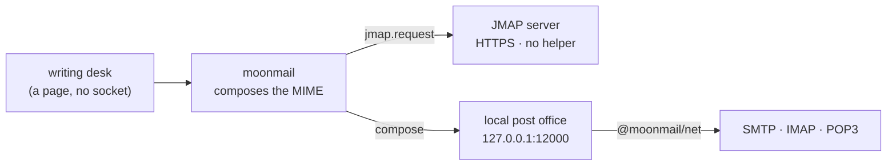

# moonmail

Email for MoonBit: read an RFC 5322 message into a tree and write it back out,
the MIME transfer encodings it carries, DKIM signing and verification, the
SMTP/LMTP, IMAP and POP3 dialogues, and JMAP over HTTP. The protocols are state machines with no
I/O, octets in and replies out, so a socket, a TLS stream and a test all look
alike; `@moonmail/net` carries them over moonnet.

```moonbit nocheck
let message = @moonmail.Message::parse(raw[:])
message.subject()          // encoded words already decoded
message.from()             // the mailboxes, display names decoded
message.text()             // the body a reader would show, by its charset
message.attachments()      // name, type, octets, inline and Content-ID

let reply = @moonmail.Message::new(
  from=@moonmail.Mailbox::new("alice@example.com", name="Alice"),
  to=[Mailbox(@moonmail.Mailbox::new("bob@example.com"))],
  subject="Re: lunch",
  text="Noon works.",
  attachments=[@moonmail.Attachment::new("map.png", png)],
)
let wire = reply.encode()  // CRLF, folded, encoded words; reads back the same
```

Every call that talks to a server raises its protocol's error on a rejection;
handle it with `try`/`catch`, or propagate it from a function declared `raise`.

Run the whole surface in one go:

```bash
moon run src/examples/tour
```

## What it does

- **Messages** — `Message::parse` and `encode`: the header unfolded and
  folded again at 78 columns, a `Headers` table that keeps order and ignores
  case and refuses a value that would start a second field, `Body` as a leaf,
  parts or an attached message, and the transfer encodings taken off and put
  back. Writing what was read and reading it again gives the same tree; what
  `7bit` cannot carry goes out in quoted-printable or base64.
- **Addresses and dates** — RFC 5322's address grammar in full, groups and the
  obsolete forms included, checked against Python's `email`; RFC 5322 dates
  with the old two-digit years and named zones.
- **Building** — `Message::new` picks `alternative`, `related` and `mixed` from
  what it carries. Quoted-printable, encoded words and charsets come from
  [moonmime](https://github.com/moonbitstack/moonmime).
- **SASL** (`@moonmail/sasl`) — PLAIN, LOGIN, CRAM-MD5, XOAUTH2, OAUTHBEARER
  (RFC 7628) and SCRAM-SHA-256 (RFC 7677) with SASLprep (RFC 4013). A
  mechanism is a trait: one you write goes to `authenticate` like these.
- **POP3** (`@moonmail/pop3`) — client with no I/O, RFC 1939 and RFC 2449:
  `USER`/`PASS`, `APOP`, SASL `AUTH`, `STLS`, `CAPA`, `PIPELINING`, `STAT`,
  `LIST`, `UIDL`, `RETR` and `TOP` dot-unstuffed with their octets kept.
- **SMTP / LMTP** (`@moonmail/smtp`) — client and server as state machines
  with no I/O, RFC 5321 and RFC 2033: `PIPELINING` groups, `SIZE`, `8BITMIME`,
  `BINARYMIME` and `CHUNKING`, `SMTPUTF8`, DSN parameters, `STARTTLS`, SASL
  `AUTH`, and RFC 3463 enhanced status codes off any reply.
- **Over a socket** (`@moonmail/net`, native and wasm) — the SMTP, LMTP, IMAP
  and POP3 state machines on moonnet: implicit TLS, STARTTLS that a server must
  offer, or the clear; sending one message in one call.
- **IMAP** (`@moonmail/imap`) — IMAP4rev2 client with no I/O (RFC 9051) that
  also speaks to IMAP4rev1 servers: the response grammar with literals and
  response codes, pipelined UID commands, `IDLE`, `CONDSTORE`, `LITERAL+`,
  `SASL-IR`, and modified UTF-7 names toward rev1 servers.
- **DKIM** (`@moonmail/dkim`) — RFC 6376 canonicalization (simple and relaxed),
  body hash, and RSA-SHA256 sign and verify.

## POP3

```moonbit nocheck
let pop = @pop3.Client::new()
pop.user("alice")
pop.pass("secret")
pop.retr(1)
// ... write pop.next_write(), feed the server's octets
for event in pop.feed(octets) {
  if event is Reply(Retr(_), Content(message)) {
    println(message.length())
  }
}
```

## SMTP / LMTP

The client queues commands and refuses, when they are queued, the ones that are
out of sequence or need an extension the server did not announce. Octets go
out through `next_write` and come back through `feed`, which reports each reply
with the command it answers.

```moonbit nocheck
let smtp = @smtp.Client::new()
smtp.ehlo("client.example")
// ... write smtp.next_write(), feed the server's octets until the EHLO reply
smtp.send("alice@example.com", ["bob@example.com"], raw[:])
smtp.quit()
for event in smtp.feed(octets) {
  match event {
    Reply(Rcpt(to), reply) if !reply.is_ok() => println("refused: " + to)
    _ => ()
  }
}
```

The server answers syntax, sequence, limits, the `354` and the chunk replies
itself, and hands the application what it decides:

```moonbit nocheck
let server = @smtp.Server::new("mx.example", auth=["PLAIN"])
server.feed(octets)
while server.next() is Some(request) {
  match request {
    Rcpt(to, _) if !known(to) => server.reply(550, "5.1.1 No such user")
    Data(message) => { store(message); server.accept() }
    Rset | Quit => ()
    _ => server.accept()
  }
}
// write server.next_write() back to the client
```

`lmtp=true` on either side speaks LMTP, where the message gets one reply per
accepted recipient.

## JMAP

SMTP, IMAP and POP3 begin with a socket, and a browser has none: no API it can
call opens a TCP connection, so no amount of WebAssembly puts the three on a
page. That is a limit of the host, not of the library, and it leaves a program
that only has a page with no way to send or read mail at all.

JMAP is the way out. RFC 8620 puts the same three jobs — list the mailboxes,
read a letter, send one — over HTTPS as JSON documents, which a page can fetch
like any other resource. `@moonmail/jmap` therefore builds and reads documents
and never touches a socket: `Session::parse` resolves the discovery document,
`Request` writes the method calls, `Response` matches the answers back by tag.
The same code runs natively and in a page.

The writing desk on the [site](https://moonbitstack.github.io/moonmail/desk.html)
is that idea with nothing else behind it: a static page, a JMAP server, and a
password. No helper to install, no port to open.

```moonbit nocheck
let request = @jmap.Request::new()
let tag = request.mailbox_get(account_id)          // Mailbox/get
let body = request.to_string()                     // POST this to session.api_url

let answer = @jmap.Response::parse(reply)
for box in @jmap.mailboxes(answer, tag) {
  println("\{box.name}: \{box.unread} unread of \{box.total}")
}
```

A server that does not speak JMAP cannot be reached from a page, whatever the
client does; for those, use `@moonmail/net` from a native program or a relay.

## The writing desk, and the post office beside it

The desk at [moonbitstack.github.io/moonmail/desk.html](https://moonbitstack.github.io/moonmail/desk.html)
writes a letter with this library and then has to send it. A page cannot: no
Web API opens a TCP connection, so the three socket protocols are out of reach
of the tab the letter was written in.

Two ways remain, and the desk offers both:

- **JMAP** — JSON over HTTPS, so the page fetches the server itself. Nothing to
  install, but only a server that speaks JMAP can be reached.
- **Local office** — the page hands the letter to `127.0.0.1`, and a small
  server there opens the SMTP, IMAP or POP3 connection. Works with any
  provider; needs that server to be running.



The office is a plugin, not part of the library: it lives on the `postoffice`
branch, and `moon run src/postoffice` serves the page and the three endpoints
it calls.

One limit is worth stating rather than discovering: the bundled TLS client
speaks TLS 1.3 only. A server that offers just 1.2 does not answer with a
version error — it hangs up during the handshake, which reads like a wrong
password if you are holding one. Personal QQ Mail is such a server; 163, 126,
Tencent Exmail, Aliyun and Fastmail all negotiate 1.3 and work. Reaching a
1.2-only server needs a client that speaks it, or JMAP.

## Over a socket

`@moonmail/net` carries the state machines over moonnet. `StartTls` refuses a
server that does not offer it rather than going on in the clear.

```moonbit nocheck
let smtp = @net.Smtp::connect("smtp.example.com", StartTls(tls))
smtp.auth(@sasl.Plain::new("alice", password))
let refused = smtp.send("alice@example.com", ["bob@example.com"], raw[:])
smtp.quit()

let imap = @net.Imap::connect("imap.example.com", Tls(tls))
imap.login("alice", password)
let inbox = imap.wait(imap.client().select("INBOX"))

let pop = @net.Pop3::connect("pop.example.com", Tls(tls))
pop.login("alice", password)
let first = pop.retr(1)
```

`tls` is a `@tls.Client` from moontls with the roots to trust. The tests run
against a local relay made of `@smtp.Server`, and in CI against Mailpit, which
takes a message by SMTP and gives it back by POP3.

## SASL

SMTP's `auth` and IMAP's and POP3's `authenticate` take any
`&@sasl.Mechanism`; the protocol does the base64 and the cancelling.

```moonbit nocheck
// SCRAM never sends the password, and refuses a server that cannot prove it
// holds the salted key. The nonce is fresh random printable ASCII each time.
smtp.auth(@sasl.ScramSha256::new("alice", "secret", nonce~))
imap.authenticate(@sasl.OAuthBearer::new(token, username="alice@example.com"))
```

A mechanism of your own implements `name`, `start` and `step`, and `finish`
when it expects proof from the server.

## IMAP

Each command returns its tag number; `feed` reports untagged responses as
`Data` and each completion as `Done` with that number.

```moonbit nocheck
let imap = @imap.Client::new()
let _ = imap.login("alice", "secret")
let _ = imap.select("INBOX")
let fetch = imap.fetch("1:*", "(FLAGS BODY.PEEK[HEADER])", uid=true)
// ... write imap.next_write(), feed the server's octets
for event in imap.feed(octets) {
  match event {
    Data(Fetch(n, items)) => println(n.to_string() + " " + items.length().to_string())
    Done(tag, No, _, text) if tag == fetch => println("fetch failed: " + text)
    _ => ()
  }
}
```

## DKIM

```moonbit nocheck
let options = @dkim.SignOptions::new(
  domain="example.com",
  selector="sel",
  headers=["From", "To", "Subject", "Date"],
)
let signature = @dkim.sign(raw[:], private_key, options)
// "DKIM-Signature: " + signature is the header to add; verify() checks it back.
```

## Beyond the basics

The pieces a caller reaches for once the simple path works:

```moonbit nocheck
// IMAP: ask about a mailbox without selecting it, wait for changes, and
// store flags only where nothing changed them since (CONDSTORE).
let _ = imap.status("INBOX", ["MESSAGES", "UIDNEXT", "UIDVALIDITY"])
let _ = imap.idle()                    // changes arrive as Data until done()
imap.done()
let _ = imap.store("1:5", "+FLAGS (\\Seen)", uid=true, unchangedsince=modseq)

// SMTP: chunk the body instead of using DATA, and ask for delivery status.
smtp.mail("alice@example.com", size=1234, body=Binary)
smtp.rcpt("bob@example.com", notify=[Success, Failure])
smtp.bdat(chunk[:], last=true)   // LAST ends the transaction
```

## What it is not

The protocol packages open no socket; `@moonmail/net` does that on the native
and wasm backends.

## The gate

```bash
moon clean && moon fmt && moon check --target all --deny-warn \
  && moon build --target all && moon test --target all
```

## Licence

Apache-2.0.
